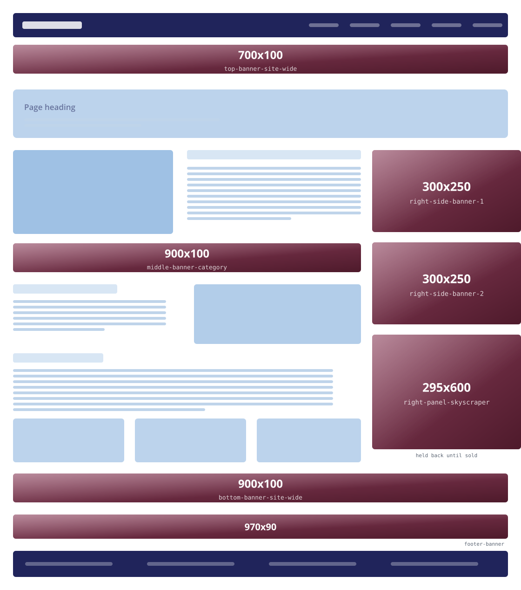
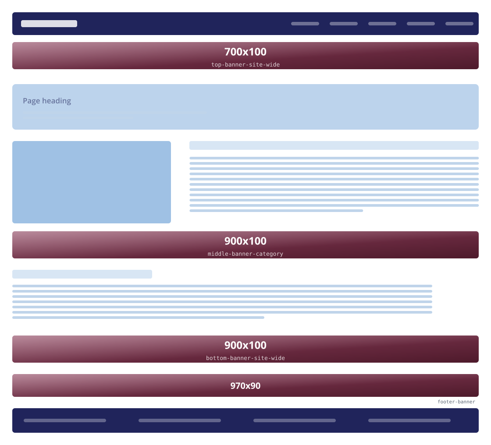
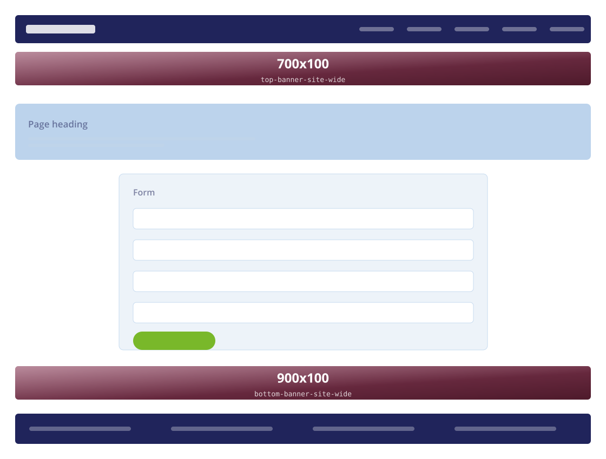

# Advertising inventory

Every public page, the ad zones it renders and the pixel box of each.

**Generated** by `python3 scripts/ad_inventory.py` from `application/controllers/User.php` and the views. Re-run it after adding or moving a zone; do not hand-edit this file.

- **28 public pages** carry advertising, **156 zone placements** in total.
- Every `slot_key` below is also a `plans.slug` on `/pricing-plan`, so buying the package
  fills the position. That is why the same key repeats across pages: a *site-wide*
  purchase is meant to be site-wide.
- An unsold zone shows a **house creative** ("advertise here") — but only the first
  `ads_house_max_per_page` of them (default **2**, at `/admin/setting`). Past that budget an
  unsold zone renders nothing at all, so a page never looks like a wall of house ads. Pages
  whose search or category comes back empty use one. The skyscraper is held back until sold
  regardless. **A sold ad is never affected by any of this** — a real booking always wins
  its position, on every device.
- The global off switch is `service_ads_enabled` at `/admin/setting`; with it off every
  zone on this page renders nothing at all, not an empty box.

## Banner sizes

| Size | Zone | `slot_key` | $/day | Where it appears |
|---|---|---|---|---|
| **900x100** | Bottom Banner (Site Wide) | `bottom-banner-site-wide` | $45.00 | 28 pages |
| **900x100** | Middle Banner (Category) | `middle-banner-category` | $25.00 | 27 pages |
| **700x100** | Top Banner (Site Wide) | `top-banner-site-wide` | $75.00 | 27 pages |
| **295x600** | Right Panel Skyscraper | `right-panel-skyscraper` | $20.00 | 24 pages |
| **300x250** | #1 Right Side Banner | `right-side-banner-1` | $25.00 | 24 pages |
| **300x250** | #2 Right Side Banner | `right-side-banner-2` | $25.00 | 24 pages |
| **900x100** | Bottom Banner (Category) | `bottom-banner-category` | $25.00 | 1 page |
| **300x250** | #3 Right Side Banner | `right-side-banner-3` | $20.00 | 1 page |
| **900x100** | Category Header Banner | `top-banner-category` | $25.00 | 1 page |

## Zones per page

| # | Page | View | Zones | Sizes |
|---|---|---|---|---|
| 1 | `/` | `index.php` | 7 | 700x100, 900x100, 300x250, 300x250, 300x250, 295x600, 900x100 |
| 2 | `/about-us` | `about.php` | 3 | 700x100, 900x100, 900x100 |
| 3 | `/all-listing` | `all-listing.php` | 6 | 900x100, 900x100, 300x250, 300x250, 295x600, 900x100 |
| 4 | `/listing-details/<slug>` | `listing_details.php` | 6 | 700x100, 900x100, 300x250, 300x250, 295x600, 900x100 |
| 5 | `/all-category` | `all-category.php` | 6 | 700x100, 900x100, 300x250, 300x250, 295x600, 900x100 |
| 6 | `/all-blog` | `blog-posts.php` | 6 | 700x100, 900x100, 300x250, 300x250, 295x600, 900x100 |
| 7 | `/blog-details/<slug>` | `blog_details.php` | 6 | 700x100, 900x100, 300x250, 300x250, 295x600, 900x100 |
| 8 | `/event` | `events.php` | 6 | 700x100, 900x100, 300x250, 300x250, 295x600, 900x100 |
| 9 | `/event-details/<slug>` | `event_details.php` | 6 | 700x100, 900x100, 300x250, 300x250, 295x600, 900x100 |
| 10 | `/news` | `news.php` | 6 | 700x100, 900x100, 300x250, 300x250, 295x600, 900x100 |
| 11 | `/news-details/<slug>` | `news_details.php` | 6 | 700x100, 900x100, 300x250, 300x250, 295x600, 900x100 |
| 12 | `/videos` | `videos.php` | 6 | 700x100, 900x100, 300x250, 300x250, 295x600, 900x100 |
| 13 | `/video-details/<slug>` | `video_details.php` | 6 | 700x100, 900x100, 300x250, 300x250, 295x600, 900x100 |
| 14 | `/classifieds` | `classifieds.php` | 6 | 700x100, 900x100, 300x250, 300x250, 295x600, 900x100 |
| 15 | `/classifieds-details/<slug>` | `classifieds_details.php` | 6 | 700x100, 300x250, 300x250, 295x600, 900x100, 900x100 |
| 16 | `/coupons` | `coupons.php` | 6 | 700x100, 900x100, 300x250, 300x250, 295x600, 900x100 |
| 17 | `/coupons/<id>` | `coupon_details.php` | 6 | 700x100, 900x100, 300x250, 300x250, 295x600, 900x100 |
| 18 | `/all-products` | `all-products.php` | 6 | 700x100, 300x250, 300x250, 295x600, 900x100, 900x100 |
| 19 | `/product-details/<slug>` | `product_details.php` | 6 | 700x100, 300x250, 300x250, 295x600, 900x100, 900x100 |
| 20 | `/house-details/<slug>` | `house_details.php` | 6 | 700x100, 300x250, 300x250, 295x600, 900x100, 900x100 |
| 21 | `/rental-details/<slug>` | `rental_details.php` | 6 | 700x100, 300x250, 300x250, 295x600, 900x100, 900x100 |
| 22 | `/services` | `services_index.php` | 3 | 700x100, 900x100, 900x100 |
| 23 | `/services/<slug>` | `service_details.php` | 6 | 700x100, 900x100, 300x250, 300x250, 295x600, 900x100 |
| 24 | `/request-quote` | `request_quote.php` | 6 | 700x100, 900x100, 300x250, 300x250, 295x600, 900x100 |
| 25 | `/post-your-ads` | `post_your_ads.php` | 2 | 700x100, 900x100 |
| 26 | `/contact-us` | `contact-us.php` | 6 | 700x100, 900x100, 300x250, 300x250, 295x600, 900x100 |
| 27 | `/search?q=` | `search.php` | 6 | 700x100, 900x100, 300x250, 300x250, 295x600, 900x100 |
| 28 | `/faq` | `faq.php` | 3 | 700x100, 900x100, 900x100 |

## Every placement, page by page

### `/`

`User::index` → `views/index.php`

| Position | `slot_key` | Size | $/day |
|---|---|---|---|
| Top Banner (Site Wide) | `top-banner-site-wide` | **700x100** | $75.00 |
| Middle Banner (Category) | `middle-banner-category` | **900x100** | $25.00 |
| #1 Right Side Banner | `right-side-banner-1` | **300x250** | $25.00 |
| #2 Right Side Banner | `right-side-banner-2` | **300x250** | $25.00 |
| #3 Right Side Banner | `right-side-banner-3` | **300x250** | $20.00 |
| Right Panel Skyscraper | `right-panel-skyscraper` | **295x600** | $20.00 |
| Bottom Banner (Site Wide) | `bottom-banner-site-wide` | **900x100** | $45.00 |

### `/about-us`

`User::about_us` → `views/about.php`

| Position | `slot_key` | Size | $/day |
|---|---|---|---|
| Leaderboard, above the content | `top-banner-site-wide` | **700x100** | $75.00 |
| In-content banner | `middle-banner-category` | **900x100** | $25.00 |
| Leaderboard, page foot | `bottom-banner-site-wide` | **900x100** | $45.00 |

### `/all-listing`

`User::all_listing` → `views/all-listing.php`

| Position | `slot_key` | Size | $/day |
|---|---|---|---|
| Category Header Banner | `top-banner-category` | **900x100** | $25.00 |
| In-content banner | `middle-banner-category` | **900x100** | $25.00 |
| Sidebar box 1 | `right-side-banner-1` | **300x250** | $25.00 |
| Sidebar box 2 | `right-side-banner-2` | **300x250** | $25.00 |
| Sidebar skyscraper | `right-panel-skyscraper` | **295x600** | $20.00 |
| Leaderboard, page foot | `bottom-banner-category / bottom-banner-site-wide` | **900x100** | $25.00 |

### `/listing-details/<slug>`

`User::listing_details` → `views/listing_details.php`

| Position | `slot_key` | Size | $/day |
|---|---|---|---|
| Leaderboard, above the content | `top-banner-site-wide` | **700x100** | $75.00 |
| In-content banner | `middle-banner-category` | **900x100** | $25.00 |
| Sidebar box 1 | `right-side-banner-1` | **300x250** | $25.00 |
| Sidebar box 2 | `right-side-banner-2` | **300x250** | $25.00 |
| Sidebar skyscraper | `right-panel-skyscraper` | **295x600** | $20.00 |
| Leaderboard, page foot | `bottom-banner-site-wide` | **900x100** | $45.00 |

### `/all-category`

`User::all_category` → `views/all-category.php`

| Position | `slot_key` | Size | $/day |
|---|---|---|---|
| Leaderboard, above the content | `top-banner-site-wide` | **700x100** | $75.00 |
| In-content banner | `middle-banner-category` | **900x100** | $25.00 |
| Sidebar box 1 | `right-side-banner-1` | **300x250** | $25.00 |
| Sidebar box 2 | `right-side-banner-2` | **300x250** | $25.00 |
| Sidebar skyscraper | `right-panel-skyscraper` | **295x600** | $20.00 |
| Leaderboard, page foot | `bottom-banner-site-wide` | **900x100** | $45.00 |

### `/all-blog`

`User::all_blog` → `views/blog-posts.php`

| Position | `slot_key` | Size | $/day |
|---|---|---|---|
| Leaderboard, above the content | `top-banner-site-wide` | **700x100** | $75.00 |
| In-content banner | `middle-banner-category` | **900x100** | $25.00 |
| Sidebar box 1 | `right-side-banner-1` | **300x250** | $25.00 |
| Sidebar box 2 | `right-side-banner-2` | **300x250** | $25.00 |
| Sidebar skyscraper | `right-panel-skyscraper` | **295x600** | $20.00 |
| Leaderboard, page foot | `bottom-banner-site-wide` | **900x100** | $45.00 |

### `/blog-details/<slug>`

`User::blog_details` → `views/blog_details.php`

| Position | `slot_key` | Size | $/day |
|---|---|---|---|
| Leaderboard, above the content | `top-banner-site-wide` | **700x100** | $75.00 |
| In-content banner | `middle-banner-category` | **900x100** | $25.00 |
| Sidebar box 1 | `right-side-banner-1` | **300x250** | $25.00 |
| Sidebar box 2 | `right-side-banner-2` | **300x250** | $25.00 |
| Sidebar skyscraper | `right-panel-skyscraper` | **295x600** | $20.00 |
| Leaderboard, page foot | `bottom-banner-site-wide` | **900x100** | $45.00 |

### `/event`

`User::event` → `views/events.php`

| Position | `slot_key` | Size | $/day |
|---|---|---|---|
| Leaderboard, above the content | `top-banner-site-wide` | **700x100** | $75.00 |
| In-content banner | `middle-banner-category` | **900x100** | $25.00 |
| Sidebar box 1 | `right-side-banner-1` | **300x250** | $25.00 |
| Sidebar box 2 | `right-side-banner-2` | **300x250** | $25.00 |
| Sidebar skyscraper | `right-panel-skyscraper` | **295x600** | $20.00 |
| Leaderboard, page foot | `bottom-banner-site-wide` | **900x100** | $45.00 |

### `/event-details/<slug>`

`User::event_details` → `views/event_details.php`

| Position | `slot_key` | Size | $/day |
|---|---|---|---|
| Leaderboard, above the content | `top-banner-site-wide` | **700x100** | $75.00 |
| In-content banner | `middle-banner-category` | **900x100** | $25.00 |
| Sidebar box 1 | `right-side-banner-1` | **300x250** | $25.00 |
| Sidebar box 2 | `right-side-banner-2` | **300x250** | $25.00 |
| Sidebar skyscraper | `right-panel-skyscraper` | **295x600** | $20.00 |
| Leaderboard, page foot | `bottom-banner-site-wide` | **900x100** | $45.00 |

### `/news`

`User::news` → `views/news.php`

| Position | `slot_key` | Size | $/day |
|---|---|---|---|
| Leaderboard, above the content | `top-banner-site-wide` | **700x100** | $75.00 |
| In-content banner | `middle-banner-category` | **900x100** | $25.00 |
| Sidebar box 1 | `right-side-banner-1` | **300x250** | $25.00 |
| Sidebar box 2 | `right-side-banner-2` | **300x250** | $25.00 |
| Sidebar skyscraper | `right-panel-skyscraper` | **295x600** | $20.00 |
| Leaderboard, page foot | `bottom-banner-site-wide` | **900x100** | $45.00 |

### `/news-details/<slug>`

`User::news_details` → `views/news_details.php`

| Position | `slot_key` | Size | $/day |
|---|---|---|---|
| Leaderboard, above the content | `top-banner-site-wide` | **700x100** | $75.00 |
| In-content banner | `middle-banner-category` | **900x100** | $25.00 |
| Sidebar box 1 | `right-side-banner-1` | **300x250** | $25.00 |
| Sidebar box 2 | `right-side-banner-2` | **300x250** | $25.00 |
| Sidebar skyscraper | `right-panel-skyscraper` | **295x600** | $20.00 |
| Leaderboard, page foot | `bottom-banner-site-wide` | **900x100** | $45.00 |

### `/videos`

`User::videos` → `views/videos.php`

| Position | `slot_key` | Size | $/day |
|---|---|---|---|
| Leaderboard, above the content | `top-banner-site-wide` | **700x100** | $75.00 |
| In-content banner | `middle-banner-category` | **900x100** | $25.00 |
| Sidebar box 1 | `right-side-banner-1` | **300x250** | $25.00 |
| Sidebar box 2 | `right-side-banner-2` | **300x250** | $25.00 |
| Sidebar skyscraper | `right-panel-skyscraper` | **295x600** | $20.00 |
| Leaderboard, page foot | `bottom-banner-site-wide` | **900x100** | $45.00 |

### `/video-details/<slug>`

`User::video_details` → `views/video_details.php`

| Position | `slot_key` | Size | $/day |
|---|---|---|---|
| Leaderboard, above the content | `top-banner-site-wide` | **700x100** | $75.00 |
| In-content banner | `middle-banner-category` | **900x100** | $25.00 |
| Sidebar box 1 | `right-side-banner-1` | **300x250** | $25.00 |
| Sidebar box 2 | `right-side-banner-2` | **300x250** | $25.00 |
| Sidebar skyscraper | `right-panel-skyscraper` | **295x600** | $20.00 |
| Leaderboard, page foot | `bottom-banner-site-wide` | **900x100** | $45.00 |

### `/classifieds`

`User::classifieds` → `views/classifieds.php`

| Position | `slot_key` | Size | $/day |
|---|---|---|---|
| Leaderboard, above the content | `top-banner-site-wide` | **700x100** | $75.00 |
| In-content banner | `middle-banner-category` | **900x100** | $25.00 |
| Sidebar box 1 | `right-side-banner-1` | **300x250** | $25.00 |
| Sidebar box 2 | `right-side-banner-2` | **300x250** | $25.00 |
| Sidebar skyscraper | `right-panel-skyscraper` | **295x600** | $20.00 |
| Leaderboard, page foot | `bottom-banner-site-wide` | **900x100** | $45.00 |

### `/classifieds-details/<slug>`

`User::classifieds_details` → `views/classifieds_details.php`

| Position | `slot_key` | Size | $/day |
|---|---|---|---|
| Leaderboard, above the content | `top-banner-site-wide` | **700x100** | $75.00 |
| Sidebar box 1 | `right-side-banner-1` | **300x250** | $25.00 |
| Sidebar box 2 | `right-side-banner-2` | **300x250** | $25.00 |
| Sidebar skyscraper | `right-panel-skyscraper` | **295x600** | $20.00 |
| In-content banner | `middle-banner-category` | **900x100** | $25.00 |
| Leaderboard, page foot | `bottom-banner-site-wide` | **900x100** | $45.00 |

### `/coupons`

`User::coupons` → `views/coupons.php`

| Position | `slot_key` | Size | $/day |
|---|---|---|---|
| Leaderboard, above the content | `top-banner-site-wide` | **700x100** | $75.00 |
| In-content banner | `middle-banner-category` | **900x100** | $25.00 |
| Sidebar box 1 | `right-side-banner-1` | **300x250** | $25.00 |
| Sidebar box 2 | `right-side-banner-2` | **300x250** | $25.00 |
| Sidebar skyscraper | `right-panel-skyscraper` | **295x600** | $20.00 |
| Leaderboard, page foot | `bottom-banner-site-wide` | **900x100** | $45.00 |

### `/coupons/<id>`

`User::coupon_details` → `views/coupon_details.php`

| Position | `slot_key` | Size | $/day |
|---|---|---|---|
| Leaderboard, above the content | `top-banner-site-wide` | **700x100** | $75.00 |
| In-content banner | `middle-banner-category` | **900x100** | $25.00 |
| Sidebar box 1 | `right-side-banner-1` | **300x250** | $25.00 |
| Sidebar box 2 | `right-side-banner-2` | **300x250** | $25.00 |
| Sidebar skyscraper | `right-panel-skyscraper` | **295x600** | $20.00 |
| Leaderboard, page foot | `bottom-banner-site-wide` | **900x100** | $45.00 |

### `/all-products`

`User::all_products` → `views/all-products.php`

| Position | `slot_key` | Size | $/day |
|---|---|---|---|
| Leaderboard, above the content | `top-banner-site-wide` | **700x100** | $75.00 |
| Sidebar box 1 | `right-side-banner-1` | **300x250** | $25.00 |
| Sidebar box 2 | `right-side-banner-2` | **300x250** | $25.00 |
| Sidebar skyscraper | `right-panel-skyscraper` | **295x600** | $20.00 |
| In-content banner | `middle-banner-category` | **900x100** | $25.00 |
| Leaderboard, page foot | `bottom-banner-site-wide` | **900x100** | $45.00 |

### `/product-details/<slug>`

`User::product_details` → `views/product_details.php`

| Position | `slot_key` | Size | $/day |
|---|---|---|---|
| Leaderboard, above the content | `top-banner-site-wide` | **700x100** | $75.00 |
| Sidebar box 1 | `right-side-banner-1` | **300x250** | $25.00 |
| Sidebar box 2 | `right-side-banner-2` | **300x250** | $25.00 |
| Sidebar skyscraper | `right-panel-skyscraper` | **295x600** | $20.00 |
| In-content banner | `middle-banner-category` | **900x100** | $25.00 |
| Leaderboard, page foot | `bottom-banner-site-wide` | **900x100** | $45.00 |

### `/house-details/<slug>`

`User::house_details` → `views/house_details.php`

| Position | `slot_key` | Size | $/day |
|---|---|---|---|
| Leaderboard, above the content | `top-banner-site-wide` | **700x100** | $75.00 |
| Sidebar box 1 | `right-side-banner-1` | **300x250** | $25.00 |
| Sidebar box 2 | `right-side-banner-2` | **300x250** | $25.00 |
| Sidebar skyscraper | `right-panel-skyscraper` | **295x600** | $20.00 |
| In-content banner | `middle-banner-category` | **900x100** | $25.00 |
| Leaderboard, page foot | `bottom-banner-site-wide` | **900x100** | $45.00 |

### `/rental-details/<slug>`

`User::rental_details` → `views/rental_details.php`

| Position | `slot_key` | Size | $/day |
|---|---|---|---|
| Leaderboard, above the content | `top-banner-site-wide` | **700x100** | $75.00 |
| Sidebar box 1 | `right-side-banner-1` | **300x250** | $25.00 |
| Sidebar box 2 | `right-side-banner-2` | **300x250** | $25.00 |
| Sidebar skyscraper | `right-panel-skyscraper` | **295x600** | $20.00 |
| In-content banner | `middle-banner-category` | **900x100** | $25.00 |
| Leaderboard, page foot | `bottom-banner-site-wide` | **900x100** | $45.00 |

### `/services`

`User::services` → `views/services_index.php`

| Position | `slot_key` | Size | $/day |
|---|---|---|---|
| Leaderboard, above the content | `top-banner-site-wide` | **700x100** | $75.00 |
| In-content banner | `middle-banner-category` | **900x100** | $25.00 |
| Leaderboard, page foot | `bottom-banner-site-wide` | **900x100** | $45.00 |

### `/services/<slug>`

`User::service_details` → `views/service_details.php`

| Position | `slot_key` | Size | $/day |
|---|---|---|---|
| Leaderboard, above the content | `top-banner-site-wide` | **700x100** | $75.00 |
| In-content banner | `middle-banner-category` | **900x100** | $25.00 |
| Sidebar box 1 | `right-side-banner-1` | **300x250** | $25.00 |
| Sidebar box 2 | `right-side-banner-2` | **300x250** | $25.00 |
| Sidebar skyscraper | `right-panel-skyscraper` | **295x600** | $20.00 |
| Leaderboard, page foot | `bottom-banner-site-wide` | **900x100** | $45.00 |

### `/request-quote`

`User::request_quote` → `views/request_quote.php`

| Position | `slot_key` | Size | $/day |
|---|---|---|---|
| Leaderboard, above the content | `top-banner-site-wide` | **700x100** | $75.00 |
| In-content banner | `middle-banner-category` | **900x100** | $25.00 |
| Sidebar box 1 | `right-side-banner-1` | **300x250** | $25.00 |
| Sidebar box 2 | `right-side-banner-2` | **300x250** | $25.00 |
| Sidebar skyscraper | `right-panel-skyscraper` | **295x600** | $20.00 |
| Leaderboard, page foot | `bottom-banner-site-wide` | **900x100** | $45.00 |

### `/post-your-ads`

`User::post_your_ads` → `views/post_your_ads.php`

| Position | `slot_key` | Size | $/day |
|---|---|---|---|
| Leaderboard, above the content | `top-banner-site-wide` | **700x100** | $75.00 |
| Leaderboard, page foot | `bottom-banner-site-wide` | **900x100** | $45.00 |

### `/contact-us`

`User::contact_us` → `views/contact-us.php`

| Position | `slot_key` | Size | $/day |
|---|---|---|---|
| Leaderboard, above the content | `top-banner-site-wide` | **700x100** | $75.00 |
| In-content banner | `middle-banner-category` | **900x100** | $25.00 |
| Sidebar box 1 | `right-side-banner-1` | **300x250** | $25.00 |
| Sidebar box 2 | `right-side-banner-2` | **300x250** | $25.00 |
| Sidebar skyscraper | `right-panel-skyscraper` | **295x600** | $20.00 |
| Leaderboard, page foot | `bottom-banner-site-wide` | **900x100** | $45.00 |

### `/search?q=`

`User::search` → `views/search.php`

| Position | `slot_key` | Size | $/day |
|---|---|---|---|
| Leaderboard, above the content | `top-banner-site-wide` | **700x100** | $75.00 |
| In-content banner | `middle-banner-category` | **900x100** | $25.00 |
| Sidebar box 1 | `right-side-banner-1` | **300x250** | $25.00 |
| Sidebar box 2 | `right-side-banner-2` | **300x250** | $25.00 |
| Sidebar skyscraper | `right-panel-skyscraper` | **295x600** | $20.00 |
| Leaderboard, page foot | `bottom-banner-site-wide` | **900x100** | $45.00 |

### `/faq`

`User::faq` → `views/faq.php`

| Position | `slot_key` | Size | $/day |
|---|---|---|---|
| Leaderboard, above the content | `top-banner-site-wide` | **700x100** | $75.00 |
| In-content banner | `middle-banner-category` | **900x100** | $25.00 |
| Leaderboard, page foot | `bottom-banner-site-wide` | **900x100** | $45.00 |

## Pages deliberately left ad-free

| Page | View | Why |
|---|---|---|
| `/checkout` | `cart_checkout.php` | Payment. An ad beside a card form costs conversions and invites phishing comparisons. |
| `/checkout-success` | `checkout_success_view.php` | The receipt. Same reason. |
| `/login, /register` | `login.php, register.php` | Someone typing a password should not be looking at an ad — it reads as less trustworthy, and the traffic is repeat users who never click one. |
| `/privacy-policy, /terms-of-use` | `privacy_policy.php, terms_of_use.php` | The pages a payment processor, an app reviewer or a cautious customer opens to check the site is legitimate. Advertising on them works against that. |
| `/pricing-plan` | `pricing_plan.php` | This page sells the ad packages. House ads pitching ad packages on the page that sells ad packages is circular — the content is the pitch. |
| `/claim-listing/<slug>` | `claim_listing.php` | A business owner proving they own a listing. Short, high-intent, and not somewhere to sell a banner. |
| `/user/*` | `user_* views` | The member dashboard is not public. Advertising to a customer inside the product they just bought is a separate decision. |
| `/admin/*` | `admin views` | Staff only. |

## Layouts

Three page shells cover every page above. `User::pageAdSlots($shape)` picks one.

### `full` — Main + sidebar



### `wide` — Full-width



### `banner` — Narrow form



## Adding a zone to a page

1. In `User::<method>()`, before the header view loads:
   `$data['ad_slots'] = $this->pageAdSlots('full');` — it primes every zone in one
   query, which is the difference between one `ORDER BY RAND()` and six.
2. In the view, where the zone goes:

   ```php
   <?php $slot = $ad_slots['top'] ?? '';
   include APPPATH . 'views/partials/ad_slot.php'; ?>
   ```

   `?? ''` matters: `ad_slot.php` treats an empty key as a no-op, so a view rendered
   from a second controller method that forgot the map degrades to nothing instead of
   erroring.
3. Re-run `python3 scripts/ad_inventory.py` so this file matches.

Selling a **new** position needs three things to line up, not one: a row in `ads_prices`
with the `slot_key`, a `plans` row whose `slug` is that same string, and a view that
includes it. Miss the first and nothing renders; miss the second and nobody can buy it.
